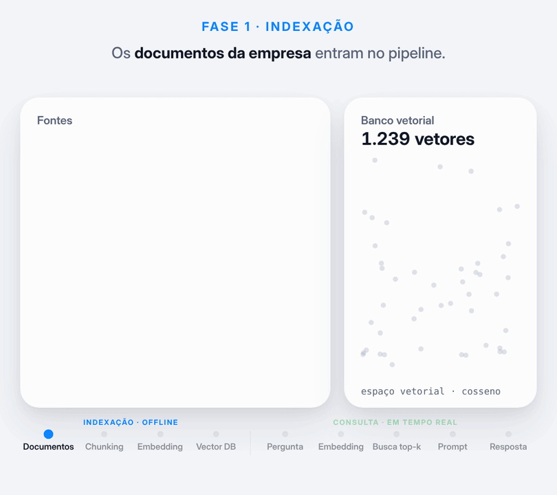

# Episódio 1 · RAG em duas fases

[](https://colab.research.google.com/github/GHDaru/linkedinmaterial/blob/main/series/ia-do-basico-ao-avancado/ep01-rag/rag_duas_fases.ipynb)



O RAG (Retrieval-Augmented Generation) tem duas fases:

1. **Indexação (offline):** documentos → chunking → embedding → banco vetorial.
2. **Recuperação e geração (tempo real):** pergunta → embedding da pergunta → busca top-k → prompt aumentado → resposta com fontes.

O notebook implementa cada etapa numa célula, com os mesmos documentos e a mesma pergunta da animação. No fim há três experimentos: pergunta sem resposta na base, tamanho do chunk e busca semântica versus busca por palavra.

**Post:** *link do post no LinkedIn*

| Arquivo | O que é |
|---|---|
| `rag_duas_fases.ipynb` | Notebook do episódio |
| `rag-duas-fases.gif` | Animação do post (810×720, loop de 16 s) |
| `rag-duas-fases.mp4` | Mesma animação em 1080×960, mais nítida no LinkedIn |
| `animacao.html` | Fonte da animação |
| `_gerar_notebook.py` | Script que gera o notebook |

Para renderizar a animação de novo:

```bash
python tools/motion/render.py series/ia-do-basico-ao-avancado/ep01-rag/animacao.html --duracao 16 --saida rag-duas-fases
```

**Prepara:** post de governança (01/11) e "o modelo virou commodity".
