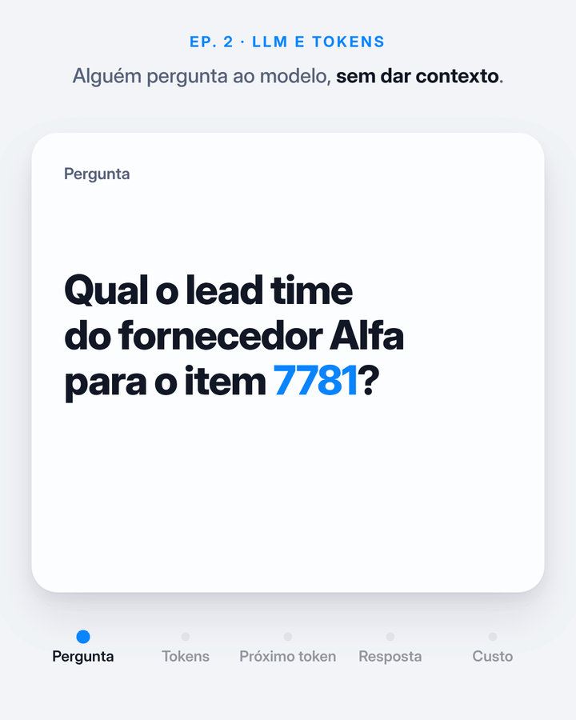

# Episódio 2 · LLM e tokens

[](https://colab.research.google.com/github/GHDaru/linkedinmaterial/blob/main/series/ia-do-basico-ao-avancado/ep02-llm-tokens/llm_tokens.ipynb)



O modelo, sozinho, não consulta nada. Ele completa texto **um token por vez**, sorteando o próximo entre os mais prováveis. Sem contexto, a continuação mais provável para "qual o lead time do fornecedor Alfa?" é um número plausível, dito com confiança e sem nenhuma fonte.

Tokens também são a **unidade de custo e de limite**. Você paga por token de entrada e de saída, e a janela de contexto é medida em tokens.

**Post:** *link do post no LinkedIn*

## Números da animação

| Dado | Valor | Origem |
|---|---|---|
| Pergunta em português | 14 tokens | medido, tokenizador `o200k_base` |
| Mesma pergunta em inglês | 14 tokens | medido, `o200k_base` |
| Frase longa sobre entrega: inglês / português | 16 / 19 tokens | medido, `o200k_base` |
| A mesma frase em português | 27 tokens | medido, `cl100k_base` (geração anterior) |
| "7781" | 2 tokens: `778` + `1` | medido, `o200k_base` |
| Probabilidades do próximo token | ilustrativas | o notebook calcula as reais |
| Custo e janela de contexto | ilustrativos | o notebook tem a calculadora |

## O notebook

Roda no Colab **em CPU e sem chave de API**, com o modelo aberto `Qwen/Qwen2.5-0.5B-Instruct`:

1. A pergunta sem contexto e a resposta inventada
2. Tokens: visualização e contagem português × inglês em três tokenizadores
3. Probabilidades do próximo token e dos prazos inteiros ("15 dias", "30 dias"...)
4. A resposta montada token por token
5. Temperatura: mesma pergunta, respostas diferentes
6. Calculadora de custo mensal (preço como parâmetro) e janela de contexto
7. Ponte com o Ep. 1: a mesma pergunta com o cadastro do fornecedor no prompt

| Arquivo | O que é |
|---|---|
| `llm_tokens.ipynb` | Notebook do episódio |
| `llm-tokens.mp4` | Animação 1080×1350 (4:5), loop de 15 s |
| `llm-tokens.gif` | Mesma animação em GIF (720 px de largura) |
| `animacao.html` | Fonte da animação |
| `_gerar_notebook.py` | Script que gera o notebook |

```bash
python tools/motion/render.py series/ia-do-basico-ao-avancado/ep02-llm-tokens/animacao.html --duracao 15 --saida llm-tokens --altura 1350 --gif-largura 720
```

**Prepara:** "Quanto custa rodar IA" (28/10) e "o modelo virou commodity".
